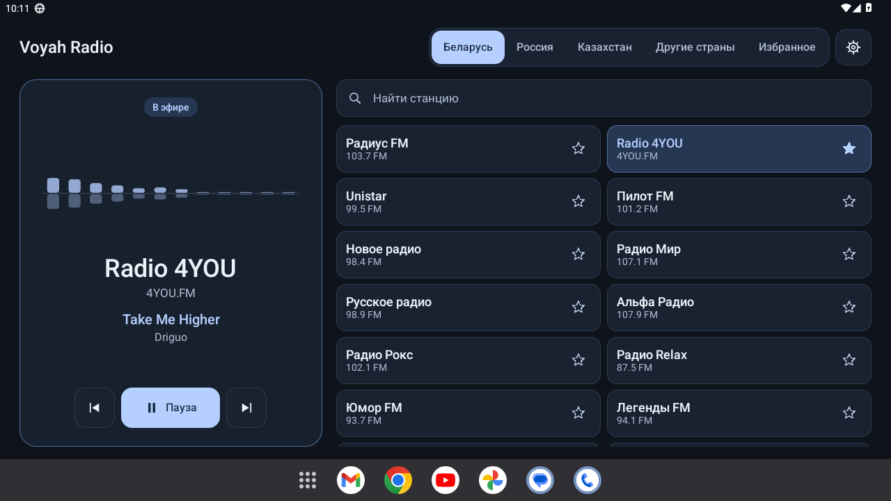
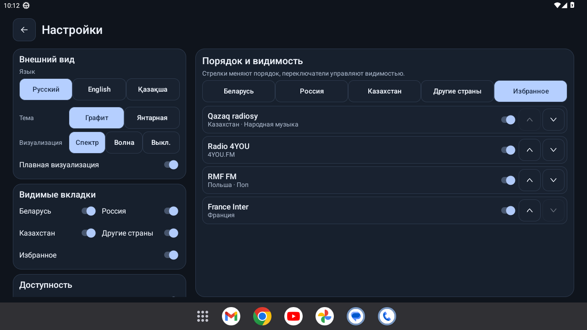
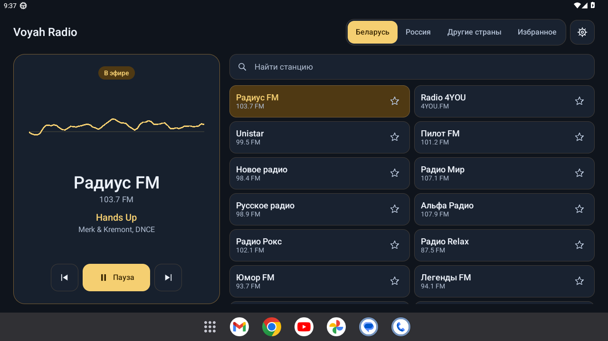
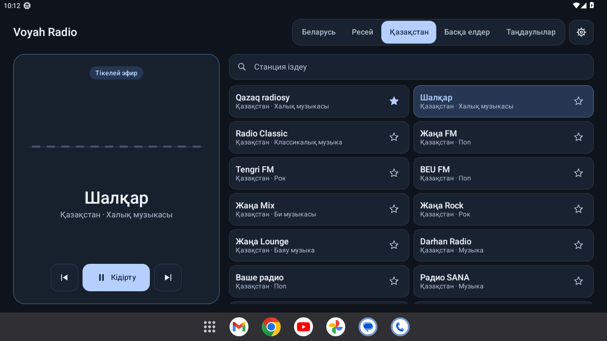
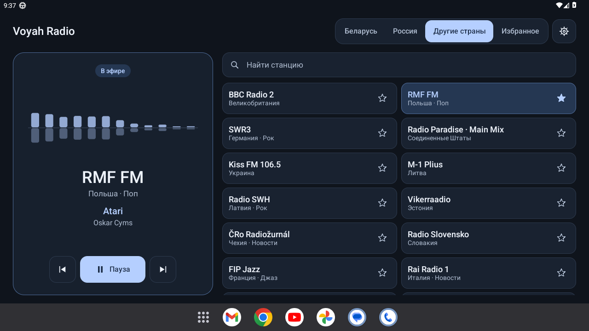
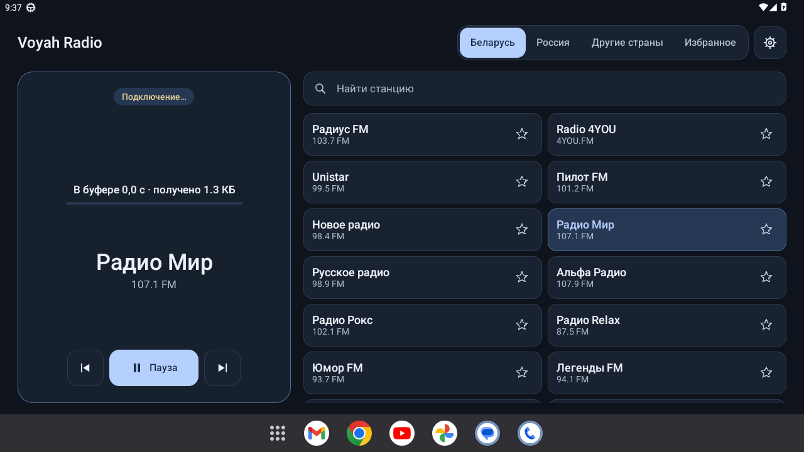

# Voyah Radio

**Языки интерфейса** — русский, английский, казахский · [English README](README_EN.md)

Приложение-компаньон для [Open Voyah Controls](https://github.com/siarheisinelnikau/open-voyah-controls). Интернет-радио для центрального экрана Voyah Free на Android 9 и новее.

- Слушайте станции Беларуси, России, Казахстана и других стран. Ищите по названию или частоте и сохраняйте любимые станции. Кнопка поиска в шапке раскрывается в строку поиска, а список всегда прокручивается к играющей станции.
- Радио открывается на последней вкладке и сразу включает последнюю станцию, как автомагнитола. Это отключается в настройках.
- Переключайте станции кнопками на руле и кнопками мультимедиа, слушайте в фоне и смотрите название трека, если станция передаёт его. С Open Voyah Controls радио появляется в медиакарточке главного экрана.
- При каждом возвращении на экран играет короткая заставка в стиле Open Voyah Controls; касание сразу её завершает, а в настройках её можно выключить.
- Настраивайте порядок и видимость станций. Выбирайте графитовую или янтарную тему, спектр или звуковую волну.

  
  
  
  

[GPLv3](LICENSE)
