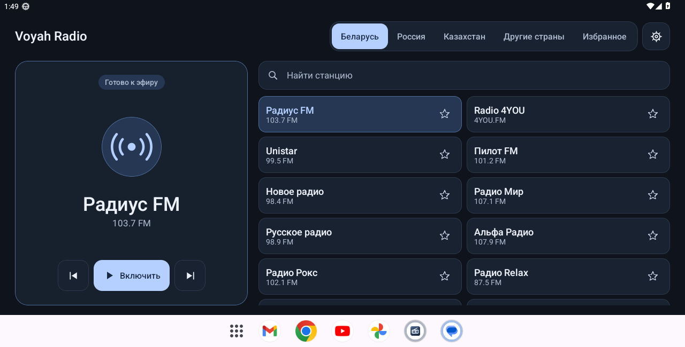
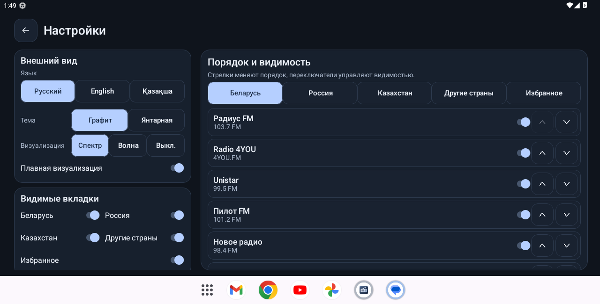

# Voyah Radio

**Interface languages** — Russian, English, Kazakh · [Русский README](README.md)

A companion app for [Open Voyah Controls](https://github.com/siarheisinelnikau/open-voyah-controls). Internet radio for the Voyah Free center display on Android 9 and later.

- Listen to stations from Belarus, Russia, Kazakhstan and around the world. Search by name or frequency and save favorites.
- Use media buttons to change stations, keep listening in the background and see the current track when the station shares it.
- Arrange or hide stations. Choose the graphite or amber theme and a live spectrum or waveform.

## Build

Run `./gradlew :app:assembleDebug :app:testDebugUnitTest` with JDK 17 or newer and Android SDK 35. The app uses one Gradle module and one Android activity. Compose collects screen state from Kotlin ViewModels, domain code handles station selection and ordering, and the Android media service owns playback.

The interface uses Compose layouts and Canvas artwork based on the original screens.

[GPLv3](LICENSE)
