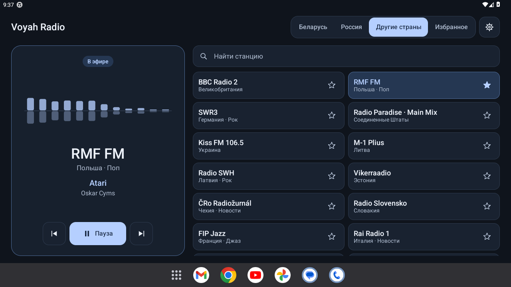
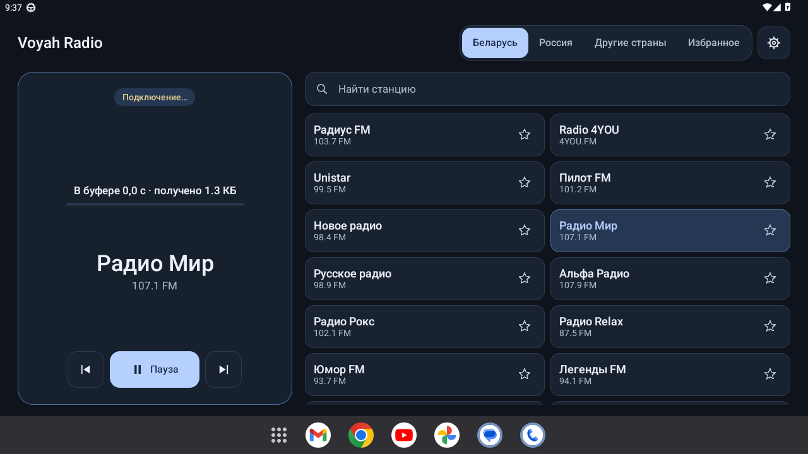

# Voyah Radio

**Interface languages** — Russian, English, Kazakh · [Русский README](README.md)

A companion app for [Open Voyah Controls](https://github.com/siarheisinelnikau/open-voyah-controls). Internet radio for the Voyah Free center display on Android 9 and later.

- Listen to stations from Belarus, Russia, Kazakhstan and around the world. Search by name or frequency and save favorites.
- Use media buttons to change stations, keep listening in the background and see the current track when the station shares it.
- Arrange or hide stations. Choose the graphite or amber theme and a live spectrum or waveform.

  
  
  
  

[GPLv3](LICENSE)
